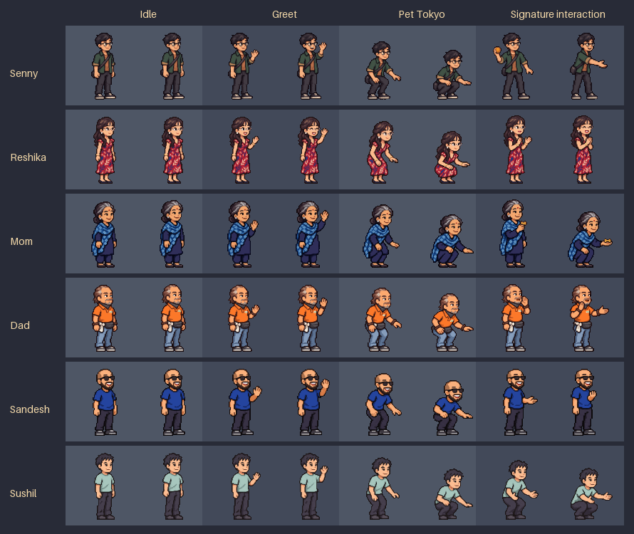

# Level 0 family sprites

Each transparent PNG is a horizontal strip of eight **112 × 112 px** frames. Frames face right and share a ground anchor at **(56, 104)** within the frame. The coordinates below use zero-based frame indices.

| Action | Frames | What the frames show |
| --- | --- | --- |
| Idle | 0–1 | A relaxed stance with a small shift. |
| Greet | 2–3 | The hand rises into a wave. |
| Pet Tokyo | 4–5 | The person bends, then reaches down toward Tokyo. |
| Individual interaction | 6–7 | The character starts their action and finishes it. |

| Character | Sprite strip | Individual interaction |
| --- | --- | --- |
| Senny | [senny.png](../../game/assets/family/senny.png) | Holds the ball, then tosses it underhand. Frame 7 has an empty hand for the release. |
| Reshika | [reshika.png](../../game/assets/family/reshika.png) | Holds her hands apart, then brings them together in a clap. |
| Mom | [mom.png](../../game/assets/family/mom.png) | Holds up a biscuit, then crouches to offer it to Tokyo. |
| Dad | [dad.png](../../game/assets/family/dad.png) | Raises a hand to call Tokyo, then gestures toward her. |
| Sandesh | [sandesh.png](../../game/assets/family/sandesh.png) | Offers an open hand, then beckons Tokyo closer. |
| Sushil | [sushil.png](../../game/assets/family/sushil.png) | Opens his arms, then crouches to welcome Tokyo. |

## Generation prompts

Built-in ImageGen drew each character from their photo and the game’s [existing NPC art](../../game/assets/people.png). Sprite Cast’s local pixel tools sized and quantized the frames on a shared palette per character before packing. The personal photos served as likeness references.

> Create a full-body character sprite sheet for Tokyo’s Journey. Use the supplied photo for likeness and outfit and the existing NPC art for crisp 16-bit side-scrolling pixel art with dark earthy outlines, flat colors, and square pixel clusters. Keep the outfit, face, colors, scale, and right-facing view consistent. Use a landscape 3:2 transparent canvas with four equal columns and two equal rows. Draw one complete pose per cell. Keep the feet on the same baseline, with padding around the body and all hands. Draw two relaxed idle poses, two wave poses, then two poses bending down to pet Tokyo, followed by two poses for the individual interaction. Keep Tokyo off-sheet and leave the background transparent.

| Character | Reference cues and final pose pair |
| --- | --- |
| Senny | Side-swept black hair, round glasses, forest-green overshirt over a brown tee, charcoal strap and jeans. Draw a ball held in his wind-up hand, then an underhand release with his hand empty. |
| Reshika | Long wavy hair with bangs, subtle glasses, and a red dress with navy and pale botanical accents. Draw her hands apart at chest height, then together. |
| Mom | Gray-streaked hair tied back, red bindi, silver earrings, and a patterned blue shawl. Draw her bringing a small biscuit near her chest, then crouching to offer it. |
| Dad | Receding brushed-back graying hair, light gray beard and mustache, an orange polo, dark gaiter and waist pack, and jeans. Draw him raising a hand to his mouth, then opening his other hand as he calls. |
| Sandesh | Shaved head, sunglasses, full beard, and a royal-blue shirt. Draw the foreground person only. Start with a palm up, then curl the fingers inward to beckon. |
| Sushil | Short tousled dark hair, an aqua tee, and dark trousers. Draw him starting to bend with arms open, then settling into a low squat with both hands open. |

## Extended Level 0 animations

The [home sprite strips](../../game/assets/family/) use the `*-home.png` suffix. Each has 14 frames. Frames 0–7 retain the base art and frames 8–13 contain the six new poses. Family members cycle through their own activity, notice Tokyo as she approaches, play their interaction on input, and settle afterward. Senny also waits for the ball and releases it on frame 11.

The built-in image generator used each person's existing sprite strip as the reference for their outfit, palette, proportions, and right-facing view. The shared prompt requested six isolated full-body poses in a transparent three-column by two-row grid with the same pixel style and foot baseline. These were the individual pose prompts in reading order:

| Character | Poses 8–13 |
| --- | --- |
| Sandesh | Read an open cream book, turn a page, lower the book and look up, start a wave, wave fully, and smile with his hand lowered. |
| Sushil | Reach toward the toy basket, bend to tidy it, partly straighten, look toward Tokyo, lower his hand to pet her, and reach farther down. |
| Reshika | Hold a cream blanket, adjust it, fold the ends together, raise her hands to clap, clap, and open her hands again. |
| Senny | Stand ready, draw the ball behind his hip, sweep it forward, release with an empty hand, watch it travel, and wave encouragement. |
| Dad | Hold a watering can, tilt it, level it and look over, call to Tokyo, reach down, and pat her. |
| Mom | Hold a biscuit, raise it to check it, lower it, greet Tokyo, bend to offer the treat, and crouch to present it. |

[prepare-family-home.py](../../scripts/prepare-family-home.py) uses Sprite Cast PixelKit to downsample and match each set to the game's existing palette. It packs the poses on the original 112 × 112 grid with the same foot anchor.

## Walking and sofa variants

Level 0 now loads the [22-frame home motion sheets](../../game/assets/family/) with the `*-home-motion.png` suffix. Frames 14–17 form a four-frame walk cycle. Frames 18–20 show a seated rest, an attentive seated pose, and a lean to pet Tokyo. Frame 21 is a relaxed standing idle that alternates with the original idle poses.

The built-in image generator used each original sprite strip as the identity and style reference. The prompt asked for four walk phases, three seated poses on an invisible sofa, and one relaxed idle in a transparent four-column by two-row grid. Each pose keeps the same right-facing perspective, outfit, palette, and pixel proportions. The `--motion` option to [prepare-family-home.py](../../scripts/prepare-family-home.py) packs those variants and makes the Level 0 furniture match the room's four-pixel grid.

## Room activities

The built-in ImageGen tool used the [family pose preview](family-sprites-preview.png) for identity, costumes, and the side-view style. Each sheet used this shared prompt followed by the two row directions below.

> Tokyo’s Journey production sprite sheet, match character designs and crisp detailed 16-bit warm brown outlined side view pixel art in the attached family reference. Actual transparent alpha canvas, no floor, shadow, labels, grid lines, scenery or extra objects. Landscape with an exact grid of THREE equal columns and TWO equal rows. Six isolated full-body sprites, one pose centered in each cell with clear generous padding. Three sequential poses of the same character per row, maintain consistent scale and constant planted feet and props. Face screen right. Seated figures sit on invisible chairs, no chair included. Hands and small props readable.

| Output | Pose directions |
| --- | --- |
| [sandesh-room.png](../../game/assets/family/sandesh-room.png) and [sushil-room.png](../../game/assets/family/sushil-room.png) | Top row Sandesh from reference (shaved head, black sunglasses, beard, royal blue tee, navy pants) seated, bent knees and shoes on floor, mobile phone held clearly to his ear in all three frames. In order, speaking and gesturing palm up with free hand, listening with free hand on knee, answering with free hand raised slightly. Bottom row Sushil (short tousled dark hair, aqua tee, charcoal pants) seated with large honey-brown acoustic guitar across his lap, guitar neck pointing right in all frames, wrist moves down/up/down as he strums, fretting hand stays on neck. |
| [mom-room.png](../../game/assets/family/mom-room.png) and [dad-room.png](../../game/assets/family/dad-room.png) | Top row Mom from the reference (gray-streaked dark bun, red bindi, blue patterned shawl and blue clothes) doing yoga, shown full height in recognizable tree pose on one leg for all three phases: palms together at chest, hands rising, palms together overhead. Same steady rooted foot. Bottom row Dad (receding brushed-back graying hair, gray beard, orange polo and blue jeans) doing a ground push-up in strict side view, head to right, completely horizontal torso and straight legs. Three phases: top high plank arms straight, elbows halfway bent, bottom chest barely off ground with elbows bent. Hands and toes remain planted at exact same positions. All three push-up poses must fit clear inside their respective cells. |
| [reshika-room.png](../../game/assets/family/reshika-room.png) and [senny-room.png](../../game/assets/family/senny-room.png) | Top row Reshika (long dark wavy hair and bangs, subtle glasses, red dress with navy and pale floral accents) sitting on an invisible stool doing makeup. Three phases: small powder brush touching cheek, brush sweeping cheek, brush lowered toward compact held in other hand. Bottom row Senny (side swept dark hair, round glasses, green overshirt over brown t-shirt, jeans) seated on invisible desk chair, concentrating on a computer to the right. Elbows bent and both hands extended forward typing on an invisible keyboard in all three poses, fingers or wrist move. Leave computer, desk and keyboard off this sheet; they are separate game scenery. |

Sprite Cast PixelKit sized and quantized the poses to the home-motion palettes, with additional wood tones for the guitar. The strips use a 112 × 112 grid and baseline y104. Seated poses align at the shoes and Dad’s push-up aligns around his planted contact points.

## Room greetings

The built-in ImageGen tool used the existing room activity strips linked above as references. Sprite Cast PixelKit matched the new art to each character’s activity palette and ground anchor. Frames 0–2 retain the activity poses. Frames 3–4 ease into the greeting and 5–6 hold the character’s attention on Tokyo. Senny’s frame 5 releases the ball from his seated toss.

> Production sheet for the existing Tokyo’s Journey game. Exact FOUR equal columns and TWO equal rows on a landscape RGBA canvas. Each cell contains one isolated complete pose with ample empty padding and genuine transparent alpha. Use the two attached three-frame activity strips as exact character and pixel-art references, first supplied character on top row, second on bottom row. Same outfit, silhouette proportions, rendering, full body at very consistent scale, original game’s warm charcoal outlines, crisp 16-bit pixel art. Faces turn slightly toward the viewer and look down at a dog in front of them, near right. Keep any seated person's buttocks in exactly the same place on the invisible chair as their reference, knees and feet in exactly the same place every frame. No dog, no chair, no backdrop, no text or floor shadow. One brief pause gesture in columns 1–2 and a pair of very similar relaxed acknowledgement poses in columns 3–4.

- **Sandesh and Sushil**. Top row Sandesh, bald with black sunglasses, dark beard and royal blue tee, remains bent-knee seated. One lowers his smartphone away from his ear, two rests it near his thigh and glances down toward Tokyo, three and four he smiles softly and acknowledges Tokyo with his head at two subtle angles, phone stays lowered. Bottom row Sushil, tousled black hair, mint tee and charcoal pants. He stays seated with the same acoustic guitar across his knees throughout, guitar neck to the right with the same position and size in each pose. One pauses his strumming, two turns his head downward toward Tokyo, three and four hold the guitar steadily while giving Tokyo an affectionate little smile and slight nod.
- **Mom and Dad**. Top row Mom keeps the same blue patterned shawl and bindi. From left to right she lowers her joined hands from the tree pose, settles the raised foot down beside the planted foot, then gently leans forward from the hips with hands at her sides, and does a subtle glance or smile down at Tokyo. Bottom row Dad keeps orange polo, jeans and receding grey hair and beard. His first pose is a modified push-up with bent knees resting on the floor and hands supporting his chest, facing right. Second he brings knees under hips into a low kneel, third and fourth he kneels back on his heels, smiling toward Tokyo and making a small open-palm greeting. Keep the large horizontal first pose wholly inside its cell. Use equal body proportions throughout even though Dad becomes taller when kneeling; do not normalize each pose's height.
- **Reshu and Senny**. Top row Reshu in red floral dress and glasses. Seated, one lowers her tiny makeup brush from her cheek, two puts both brush and compact low on her lap, three and four she smiles slightly down toward Tokyo with makeup tools in her lap and gives a little nod. Bottom row Senny wears green overshirt, round glasses and jeans. He is NECESSARILY seated throughout all FOUR poses. One pauses typing and turns shoulders a little toward camera, holds his small bright orange fetch ball over his lap. Two winds his hand holding the ball slightly back. Three underhand tosses down and forward with open EMPTY palm, other hand near thigh. Four lowers the empty hand and watches the dog. Keep the chair and all floor and furniture invisible. The small orange ball appears in poses ONE and TWO ONLY.
